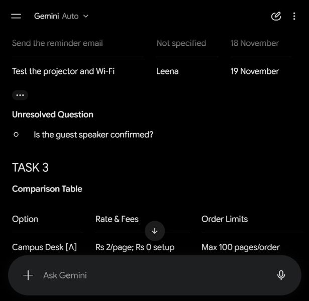
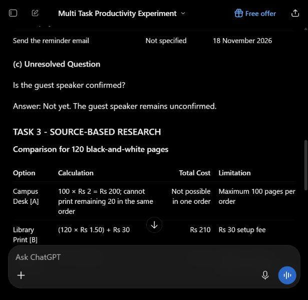

# Comparing ChatGPT, Gemini and Copilot on Four Productivity Tasks

A printing comparison can name the cheapest shop and still give incorrect reasoning. That happened in the Topic 79 experiment, which tested how well three browser assistants turned the same material into usable work.

## Problem and tools

The goal was to compare ChatGPT, Google Gemini and Microsoft Copilot on summarization, note-taking, source-based research and writing. The experiment used their browser interfaces, one shared prompt and a structured comparison log.

## Workflow

**Common prompt → fresh chat in each tool → draft response → capture output → check against the same criteria**

## Steps to reproduce

1. Open the companion prompt.txt file. It contains an AI paragraph, a fictional workshop transcript, three synthetic printing extracts and instructions for an announcement email.
2. Start a fresh chat in each tool and send the same four-task prompt. Use the supplied materials as the source for each answer.
3. Save the first complete outputs. Check summary length, meeting decisions and action owners, printing arithmetic and email requirements.
4. For a separate timing run, start from a fresh chat again. Measure from Send to the first browser observation that confirms the full response has finished. Record the time for the four tasks together.
5. Enter the observations in comparison_log.csv and retain screenshots of the original outputs.

## Outputs and observations

| Task | Observed result |
|---|---|
| Summarization | All three met the three-bullet format. |
| Note-taking | All three captured two decisions and three actions and preserved the unassigned reminder owner. |
| Source comparison | All three selected Library Print at Rs 210. Gemini showed the Rs 240 Campus Desk total and explained that two orders were needed. Copilot showed the total and left the split implicit. ChatGPT incorrectly described Campus Desk as cheaper per page. |
| Email | ChatGPT produced 81 words, Gemini 90 and Copilot 92. All included the confirmed workshop details. |

*Figures show the original browser outputs from the quality trial.*

The separate timing follow-up observed **5.86 seconds for ChatGPT, 7.56 seconds for Copilot and 10.42 seconds for Gemini**. Each value covers the entire four-task response in one accepted run. A manual baseline and review time were unmeasured, so actual time savings remain unknown.

## Challenges and lessons

The completion control differed across sites, so the timed run used each site's visible completion signal. The research task used synthetic excerpts, which made arithmetic and source claims checkable and kept the test focused on evidence synthesis. The sample was small, and account-specific access and subscription limits can affect reproducibility. The workshop data was fictional to avoid exposing private details.

For these inputs, all three were useful for summaries and meeting notes. Gemini required the least clarification on the printing comparison. When using an AI draft to make a decision, check the calculation and operational restrictions before acting on its recommendation.

## References

- [Shared four-task prompt](prompt.txt). Exact input used across the three tools.
- [Topic 79 comparison log](comparison_log.csv). Primary record for the quality observations and browser timings.
- [Gemini evidence](gemini-task3.jpg) and [ChatGPT evidence](chatgpt-task3.jpg). Original printing-task screenshots.
- Liang et al., [Holistic Evaluation of Language Models](https://arxiv.org/abs/2211.09110). Background for comparing tools across multiple tasks and publishing inputs and outputs.
- [Stanford HELM Classic](https://crfm.stanford.edu/helm/classic/latest/). Examples of task-specific evaluation metrics.
- [NIST Generative AI Risk Management Profile](https://nvlpubs.nist.gov/nistpubs/ai/NIST.AI.600-1.pdf). Background on checking plausible but inaccurate AI output.
- [Microsoft Copilot Privacy FAQ](https://support.microsoft.com/en-us/microsoft-copilot/privacy-faq-for-microsoft-copilot). Product guidance for the privacy discussion.

## Theory behind the practical comparison

### Why use the same prompt?

A comparison is easier to interpret when every tool gets the same source text, instructions and output constraints. Fresh chats reduce differences from prior messages. The experiment compared the complete browser products as observed, so account settings, model routing and interface behavior may still affect the results. A single run per tool gives a case study rather than an estimate of typical performance. [HELM evaluation framework](https://arxiv.org/abs/2211.09110)

### Accuracy, grounding and instruction following

Accuracy asks whether the answer gets the facts or arithmetic right. Grounding asks whether the explanation follows from the evidence provided. Instruction following asks whether the output respects requested limits and structure. These criteria can disagree. In the printing task, choosing Library Print at Rs 210 was accurate, while calling Campus Desk cheaper per page was unsupported. Reviewing each criterion separately makes this difference visible. [NIST Generative AI Profile](https://nvlpubs.nist.gov/nistpubs/ai/NIST.AI.600-1.pdf)

### Response time and productivity

The browser timer covered the interval from Send to the first observed completion signal. That interval includes network, generation and interface delays. A full productivity comparison would also time prompt preparation, verification and editing. Subtract the total assisted time from the manual time for equivalent work to estimate net savings. This experiment measured browser response times and left the manual baseline unmeasured.

### Main findings

- **Summary and notes:** All three delivered the requested structure in the observed examples.
- **Printing comparison:** Gemini explained the split-order constraint most clearly in the original trial.
- **Writing:** All three emails met the requested word-count range.
- **Timing:** ChatGPT finished first in the separate observed timing runs. More trials are needed to compare typical speed.

## Detailed evaluation theory

### Unit of comparison and controls
The unit was one browser-product response to a bundle of four tasks. Each product received the same source materials and format requirements in a fresh chat. This controls differences arising from the prompt and previous conversation. Account settings, automatic model selection, browser behavior and service load could still differ. The observed timing belongs to the complete four-task response, so it cannot be assigned to an individual task.

### Define a rubric before reading outputs
A rubric turns “good answer” into observable checks. For a summary, count bullets and compare the main claims with the paragraph. For meeting notes, check the decisions, actions and owners against the transcript. For research, recalculate totals and check whether operational constraints affect the result. For writing, check the requested word count, required details and unsupported additions. Record the evidence behind each judgment so someone else can review it. [HELM evaluation framework](https://arxiv.org/abs/2211.09110)

### Worked example of a reference answer
Library Print charges Rs 1.50 per page and a Rs 30 setup fee. For 120 pages the total is 120 × 1.50 + 30 = Rs 210. Campus Desk charges Rs 2 per page with no setup fee, so the total is 120 × 2 = Rs 240. Its maximum of 100 pages per order means 120 pages require at least two orders. Student Center comes to 120 × 1.80 = Rs 216. These calculations separate three checks: the recommended provider, the numerical justification and the order-size condition.

### Measure completion and reviewer effort separately
The browser measurement started when Send was triggered and stopped when the interface showed its completion signal. Network delay, the service response and browser rendering all contribute to the observation. In a follow-up comparison, record prompt preparation, response time, verification and corrections as separate stages. The sum is the assisted completion time. Subtract it from a timed manual attempt with equivalent materials to estimate net time saved.

### Repetition and reliable interpretation
One accepted timing run per tool shows what happened in those runs. A larger evaluation could repeat trials, alternate tool order and report the median and range. Reviewers could score outputs against an answer key with tool names hidden, then compare judgments on disagreements. These steps would help distinguish a repeated advantage from ordinary variation.

### Evidence, privacy and reproducibility
The experiment uses fictional workshop material and synthetic source extracts. This keeps sensitive input out of the study and makes the expected results independently checkable. The prompt and comparison log let readers reproduce the workflow. Repeat runs may yield different wording and timings because product settings and service behavior can change. [Project files and evidence](https://github.com/ram2920sai-hash/project-79)

## Extended evaluation methodology

### Operational definitions and scoring

Define each outcome before evaluating the answers. A three-bullet requirement is a format check. Preserving an unassigned owner is a factual check. Explaining the 100-page order limit is a completeness check. A rubric can mark each criterion separately as met, partially met or missed. With a small sample, reporting the individual judgments lets readers see where the tools differ without hiding those differences in a single average.

### Source coverage and evidence mapping

A review sheet can give every required claim its own row, with columns for the expected fact, the source passage, the model wording and the verdict. This makes omissions visible alongside errors. A research answer might correctly identify the cheapest provider but omit the condition that one provider requires two orders. The omission belongs in the evidence record even though the final ranking is correct.

### Worked error analysis by task

In a summary, an invented consequence is an unsupported addition. In notes, assigning an unclaimed task to someone is a mistaken inference. In research, using the right final price with a wrong comparison of unit rates is a reasoning error. In writing, including the correct date in an email that exceeds the requested length is a format failure. These categories guide different fixes, from changing the prompt to verifying the source or checking the format automatically.

### What the timings measure

The clock began at submission and ended at the first observed completion signal. This browser interval includes the network, the service and the interface. An observation occurs after completion, so the displayed time can lag the actual transition. First-token latency would instead end when the first output appears, and throughput would require a count of completed tokens. The existing experiment measured full response completion for the four-task bundle.

### How to measure actual time saved

Give the same material to someone completing the tasks manually and to someone using an assistant. Record reading, drafting and review time for both approaches. For the assisted workflow, include prompt preparation, model response time and corrections. With an illustrative manual time of 12 minutes and an assisted total of 8 minutes, the saving is 4 minutes, or about 33% of manual time. The example explains the calculation. The Topic 79 runs do not supply a manual baseline.

### Reliability and repeated trials

Repeat the comparison with several source sets and vary the order in which tools are tested. Report the median and observed range alongside the sample size. Separate connection failures or interrupted runs from completed responses and document exclusions. To check whether a result depends on wording, use equivalent prompt variations while retaining the same task criteria. [HELM evaluation framework](https://arxiv.org/abs/2211.09110)

### From evaluation to a tool-selection decision

Choose criteria that match the work. A meeting organizer may care most about accurate action ownership. Someone comparing suppliers may prioritize calculations and constraints. An editor may prioritize factual fidelity, tone and revision effort. Use the evidence from each task to guide a choice, and repeat the test with input that resembles the intended work before making a broader decision.
